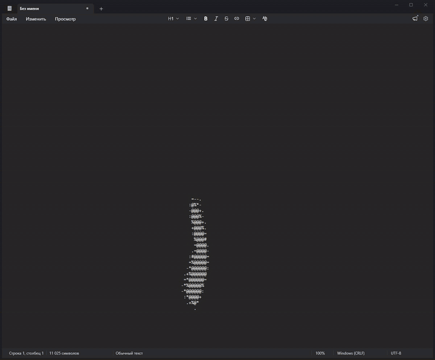
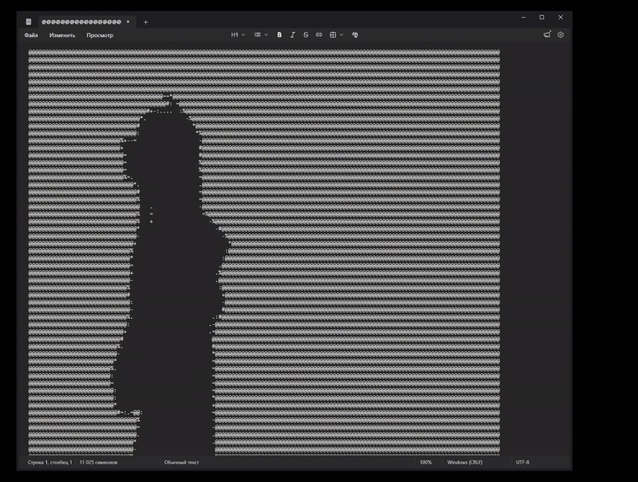

# Bad Apple!! in Windows Notepad

Who said Notepad was only good for taking notes?

This project plays the Bad Apple!! shadow-art PV directly inside a real Windows Notepad window, using ASCII characters instead of video. It runs at 30 FPS, with the animation synced to the original audio.

The whole thing is written in a single C file. No frameworks, no extra libraries to install, just the Windows API and `ffmpeg.exe`.



## Resizing

The character grid automatically adjusts to the size of the Notepad window. The video keeps its original 4:3 aspect ratio, so resizing the window won't stretch or distort the animation. Any leftover space is filled with blank margins.



Both GIFs were recorded from the actual program running in Notepad.

## How it works

```text
bad_apple.mp4 ──ffmpeg──> raw gray 480×360 @30fps ──pipe──> box downsampler
                                                                  │
                                                            " .:-=+*#%@"
                                                                  │
                                                      WM_SETTEXT ──> Notepad

bad_apple.mp4 ──ffmpeg──> bad_apple.wav ──PlaySoundA──> speakers
```

A quick breakdown of what's happening:

- **Video decoding:** FFmpeg decodes the video into raw 8-bit grayscale frames and sends them through a pipe. Each frame is exactly 480×360 pixels.
- **ASCII conversion:** Each frame is scaled down to fit the available character grid. Pixel brightness is then mapped to a 10-character ramp, from dark to bright: `" .:-=+*#%@"`.
- **Displaying frames:** The resulting text is sent directly to Notepad's edit control using `WM_SETTEXT`. This works with both the classic Win32 `Edit` control and Windows 11's newer `RichEditD2DPT` control.
- **Audio:** FFmpeg extracts the audio into `bad_apple.wav` once. The file is cached next to the video and played using `PlaySoundA`.
- **Frame timing:** `QueryPerformanceCounter` keeps everything on an absolute 30 FPS schedule. If a frame takes too long, it's skipped rather than slowing down the entire animation.
- **Window resizing:** The program measures the actual font dimensions and recalculates the character grid whenever the window changes size. It also picks up font zoom changes while running.

## Requirements

- Windows 10 or 11
- [FFmpeg](https://www.gyan.dev/ffmpeg/builds/) available on `PATH` (or in the working directory)
- `bad_apple.mp4` — you'll need to provide your own copy
- A C compiler (MinGW-w64 / GCC or MSVC)

The program accepts other videos too. Non-4:3 sources are automatically letterboxed by FFmpeg.

Tested on Windows 11 (build 26300) with GCC 16.2 and MSVC 19.x, using both the classic `Edit` control and Windows 11's `RichEditD2DPT`.

## Building

**MinGW-w64:**

```sh
gcc -O2 -Wall -Wextra -std=c99 bad_apple_notepad.c -o bad_apple_notepad.exe -lwinmm -lgdi32
```

**MSVC:**

```bat
cl /O2 /W3 bad_apple_notepad.c /link winmm.lib gdi32.lib
```

You can also just run `build.bat`, which attempts to build with both compilers.

## Running

```bat
bad_apple_notepad.exe
bad_apple_notepad.exe D:\videos\bad_apple.mp4
```

Place `bad_apple.mp4` in the same directory as the executable, or pass the path to another video as an argument.

On the first run, FFmpeg extracts the audio into `bad_apple.wav` next to the source video. This takes a few seconds. After that, the cached WAV file is reused.

The program launches a fresh Notepad window automatically, sizes it to roughly 70% of your desktop and centres it on screen.

Once it starts, just leave Notepad alone and enjoy the show. Close the window or press `Ctrl+C` in the console to stop playback.

## Recommended Notepad settings

For the best results:

- **Font:** Consolas (or another monospaced font)
- **Font size:** 10–11pt
- **Word Wrap:** Off
- **Zoom:** 100%

The program adapts to different fonts and zoom levels, including changes made with `Ctrl` + mouse wheel. However, a monospaced font with word wrap disabled gives the cleanest result.

## Technical notes

A few things worth mentioning about the implementation:

- `WM_SETTEXT` and `WM_GETTEXT` are handled across processes by Windows itself. There's no DLL injection or external automation framework involved.
- Windows 11 Notepad can relaunch itself into a different process. Because of this, the program looks for a newly created Notepad-class window instead of relying on the original process ID.
- Windows 11's text control places its scrollbars in the non-client area. Measuring the client rectangle instead causes a feedback loop where the scrollbar changes the available grid, which then changes the scrollbar again.
- `tmAveCharWidth` isn't always the actual width of a monospaced character. Instead, the program measures the width of 32 `M` characters to get a more reliable result. Getting this wrong causes lines to wrap and the image to become distorted.
- Audio and video use the same timing reference. `PlaySoundA` runs asynchronously, allowing the animation to continue without waiting for audio playback.
- Notepad can still struggle to keep up with very large windows. Updating roughly 30,000 characters 30 times per second through the Windows message queue has its limits.

## License

MIT — see [LICENSE](LICENSE).

Bad Apple!! is © its respective rights holders. This repository does not include the original video or audio files.
